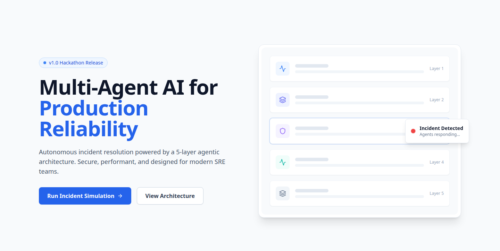
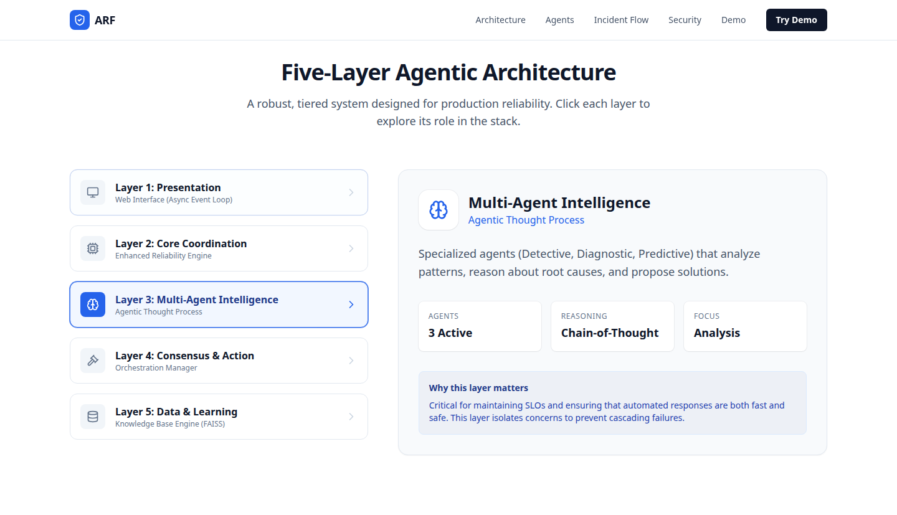
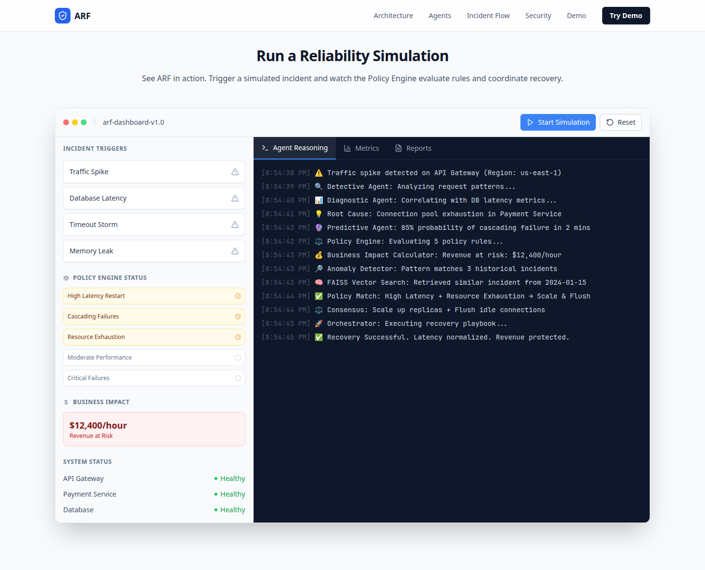
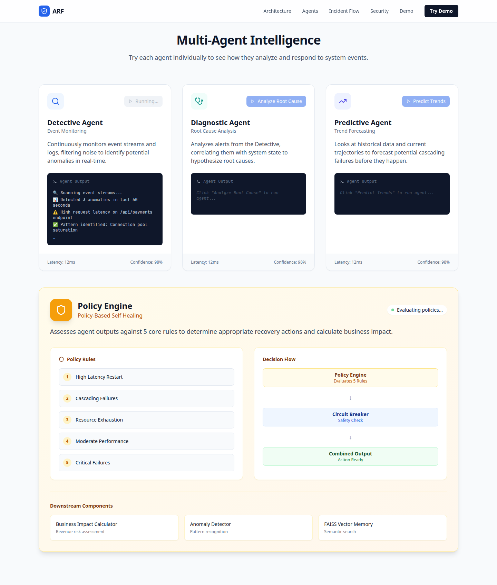
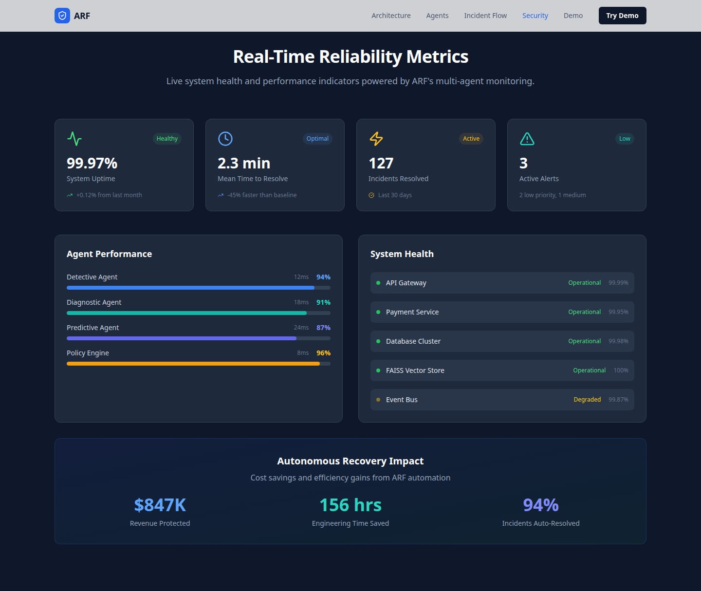
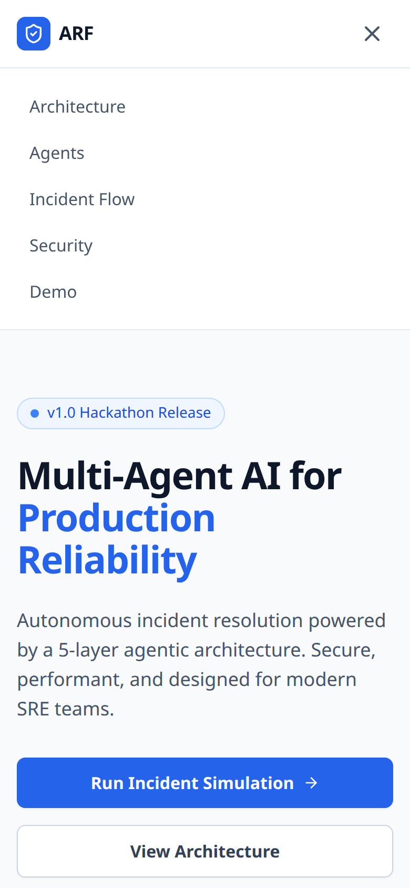

# ARF Marketing Demo UI

Public portfolio frontend for [Shay Bouchles](https://github.com/shaythegay13). It is a hackathon site for ARF, an AI governance infrastructure layer.

The page presents a five-layer agent model, a scripted incident simulation, and a reliability dashboard. This repository is that interface only. It does not call a model, a policy service, a vector database, or a metrics API. Transcripts, policy results, and every figure on the page are copy in the React components.

## What it does

`App` renders one page, in this order:

1. **Navigation.** Sticky links for Architecture, Agents, Incident Flow, Security, and Demo, plus a Try Demo button. On small screens the same links open from a menu button.
2. **Hero.** A “v1.0 Hackathon Release” badge and the headline “Multi-Agent AI for Production Reliability.” Run Incident Simulation jumps to the demo. View Architecture jumps to the architecture section. The stack graphic is decorative: the layer names in the source are not drawn on the bars.
3. **Architecture.** Five buttons. The selected layer shows its title, subtitle, description, and three stored labels.
4. **Demo.** Start Simulation, four incident triggers, and Reset all play one fixed sequence. The sequence appends a timestamped log, marks three of five policy rules as matched, and shows a business-impact string. The Metrics and Reports tabs are placeholders. Reset clears the log, the rule marks, and the impact figure, and cancels timers that have not fired.
5. **Agents.** Detective, Diagnostic, and Predictive each play a fixed transcript from a button. A Policy Engine panel lists five rules and a static decision flow: Policy Engine, Circuit Breaker, Combined Output. Under that are three labels: Business Impact Calculator, Anomaly Detector, and FAISS Vector Memory. Each agent card also prints “Latency: 12ms” and “Confidence: 98%”; those strings are not calculated.
6. **Incident flow.** Six static steps from an incoming event through recovery.
7. **Security.** The Security link scrolls to the section titled “Real-Time Reliability Metrics.” Uptime, mean time to resolve, incident counts, agent bars, service rows, and the recovery totals are literals in that component.
8. **Use cases.** Three cards: SRE Teams, Platform Engineering, and Infra & Cloud Ops, each with a static value label.
9. **Footer.** “Hackathon Prototype • Production-Conscious Architecture”, a link to this repository, and badges that read Python 3.10, Security: Patched, Tests: 40+, and Coverage: 80%+. Those badges are text. This repository has no Python package, no test suite, and no coverage report.

### Scripted incident

Every trigger runs the same script. The log, in order:

- Traffic spike on API Gateway in `us-east-1`
- Detective Agent analyzing request patterns
- Diagnostic Agent correlating database latency
- Root cause: connection pool exhaustion in Payment Service
- Predictive Agent: 85% probability of cascading failure in 2 minutes
- Policy Engine evaluating 5 rules
- Business impact calculator: `$12,400/hour`
- Anomaly detector: 3 historical incidents
- FAISS vector search: a similar incident dated 2024-01-15
- Policy match: High Latency + Resource Exhaustion, then scale and flush
- Consensus: scale up replicas and flush idle connections
- Orchestrator executing a recovery playbook
- Recovery successful

The script marks High Latency Restart, Cascading Failures, and Resource Exhaustion as matched. Moderate Performance and Critical Failures stay unmatched.

In the demo sidebar, API Gateway and Database stay “Healthy.” Payment Service shows “Degraded” only while that script’s timers are running.

The incident-flow copy says “4 agents run in parallel.” The agents section renders three named agents plus a separate Policy Engine panel. Both are page copy. Neither number is a process running in this repo.

## Stack

Installed and built with Node.js 22.14.0 and npm 10.9.9. Ranges below are from `package.json`. Resolved versions are from that install.

| Package | Declared | Resolved here |
| --- | --- | --- |
| React / React DOM | ^18.3.1 | 18.3.1 |
| TypeScript | ^5.5.4 | 5.9.3 |
| Vite | ^5.2.0 | 5.4.21 |
| `@vitejs/plugin-react` | ^4.2.1 | 4.7.0 |
| Tailwind CSS | 3.4.17 | 3.4.17 |
| PostCSS | latest | 8.5.30 |
| Autoprefixer | latest | 10.6.1 |
| lucide-react | 0.522.0 | 0.522.0 |
| ESLint | ^8.50.0 | 8.57.1 |

There is no router, no data client, and no backend. Tailwind is applied from `src/index.css` through PostCSS.

## Architecture

```text
index.html
└── src/index.tsx          createRoot into #root
    └── src/App.tsx
        ├── Navigation
        ├── Hero
        ├── ArchitectureSection
        ├── DemoSection
        ├── AgentsSection
        ├── IncidentFlowSection
        ├── SecurityPerformanceSection
        ├── UseCasesSection
        └── Footer
```

Vite serves `public/`, including `favicon.svg`. Component state stays in React. The demo and agent panels schedule their lines with `setTimeout`. Nothing is stored after refresh.

The five layers described on the page are Presentation, Core Coordination, Multi-Agent Intelligence, Consensus & Action, and Data & Learning. The last of those is labeled “Knowledge Base Engine (FAISS).” This repository renders those descriptions. It does not implement them.

## Hackathon context

The hero calls this build the “v1.0 Hackathon Release.” The footer calls it a “Hackathon Prototype.”

Git history is three commits on 4 December 2025, all by Shay Bouchles:

- `8ef2944` — initial commit. The README was the Magic Patterns stub “ARF-Marketing-Demo-UI / Synced from Magic Patterns.”
- `19f63d5` — `[Magic Patterns] Updated from 'UI: Reorder sections and features'`. This commit added the Vite app.
- `88c6218` — the same message, with no file changes. That commit is current `main`.

The UI was generated from this Magic Patterns design: [sfmk7bz4dsiu3zmlhut3gn](https://www.magicpatterns.com/c/sfmk7bz4dsiu3zmlhut3gn).

## Screenshots

Captured from `npm run dev` at `http://127.0.0.1:5173/` on 14 October 2026. Desktop shots are a 1440×900 viewport. The mobile shot is 390×844 with the menu open.

Figures in the simulation and metrics shots are the strings rendered by the page, not measurements from a running ARF service.

### Hero



### Architecture

Layer 3, Multi-Agent Intelligence, selected.



### Incident simulation

The script after it finishes. `$12,400/hour` is the business-impact string in `DemoSection`.



### Agents

Detective after Scan Events. The other two cards stay on their idle prompt until their own buttons are used.



### Security metrics

The target of the Security link. Totals such as 99.97% uptime, 127 incidents, and $847K are literals in `SecurityPerformanceSection`.



### Mobile navigation



## Setup

```bash
npm ci
npm run dev
```

The dev server prints a local URL. In this environment it was `http://127.0.0.1:5173/`.

```bash
npm run build       # writes dist/
npm run preview     # serves dist/
npm run lint
npm run typecheck   # tsc -b
```

`npm run build` does not typecheck. `npm run typecheck` writes the Vite config’s emit under `node_modules/.cache/tsconfig-node`, which is gitignored.

## Environment

The app reads no environment variables. `.env` and `.env.*` are gitignored. `.env.example` is the exception and contains names only. There are no names yet, because nothing in `src/` reads `import.meta.env` or `process.env`.

`.env` is not in the working tree and was not in git history.

## Contributors

From `git shortlog`:

- **Shay Bouchles** — 3 commits, the entire history of this repository.

## Known limitations

- No test suite, no CI workflow, and no license file.
- Footer badges for Python, tests, coverage, and “Security: Patched” are not backed by files in this repo.
- Demo Metrics and Reports tabs are placeholders.
- Incident-flow copy says four parallel agents. The agents section shows three named agents.
- `postcss` and `autoprefixer` are declared as `latest`, so a future install can resolve different versions than the lockfile if the lockfile is not used. `npm ci` follows `package-lock.json`.
- `npm audit` on this install reported 15 advisories in the dependency tree: 12 high and 3 moderate. They sit in the ESLint 8, Tailwind, and Vite trees. They were left in place; a forced audit fix would be a breaking upgrade, not a small patch.
- The hero graphic does not print the layer names that exist in its data.
